# Expense Splitter (Kotlin Multiplatform)

Split shared expenses between friends, on Android and iOS, from one Kotlin codebase.
Business logic, data, presentation (ViewModels) **and UI** (Compose Multiplatform) are shared;
each platform keeps a thin native entry point.

## Screenshots

Android, light and dark theme (iOS renders the same shared Compose UI).

| Home | Groups | Group Details: Expenses | Group Details: Balances |
|---|---|---|---|
| 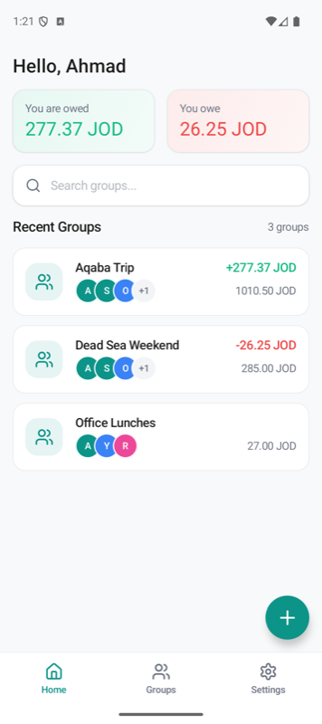 | 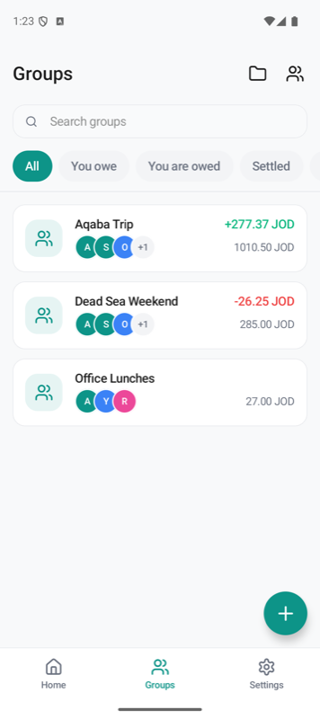 | 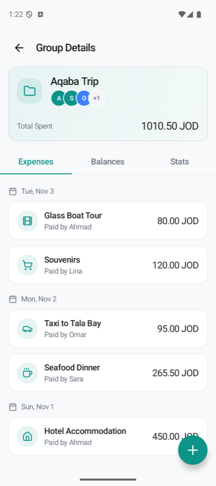 | 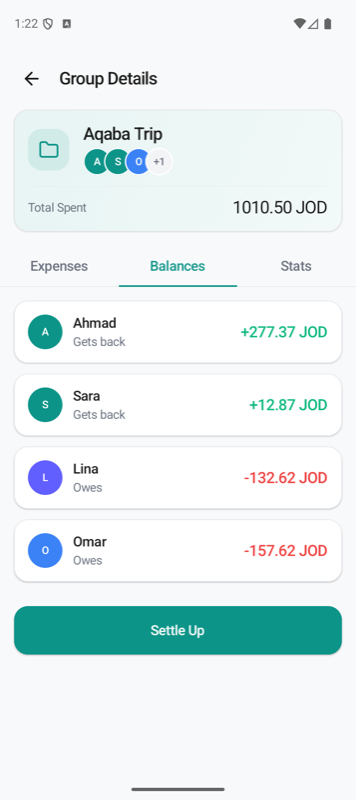 |

| Settle Up | Stats: summary | Stats: charts | Expense Details |
|---|---|---|---|
| 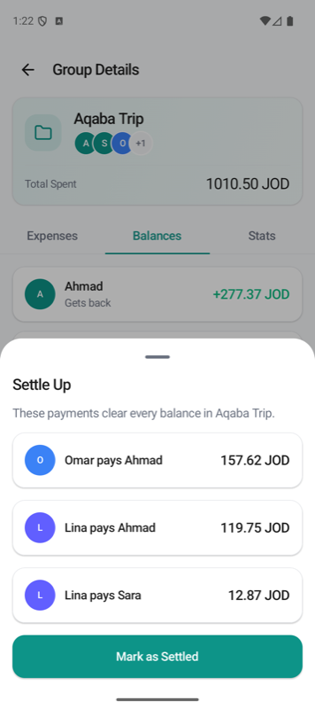 | 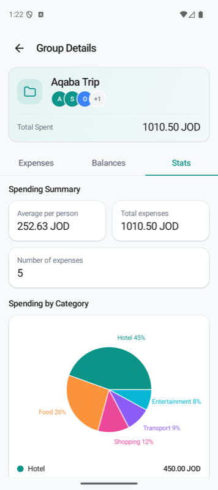 | 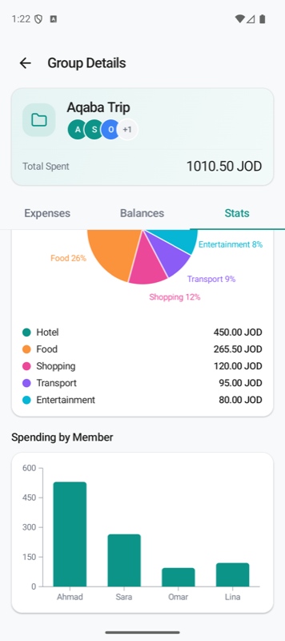 | 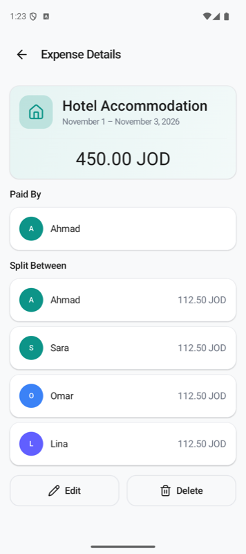 |

| Add Expense | People group sheet | Manage people groups | Settings |
|---|---|---|---|
| 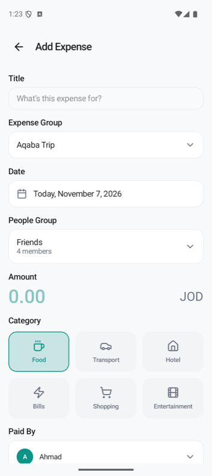 | 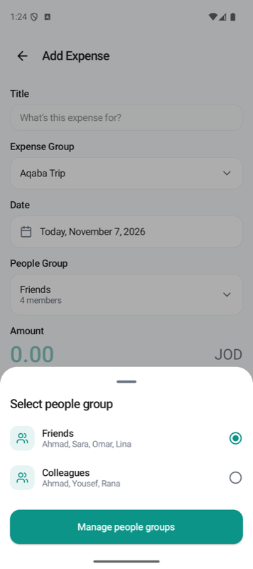 | 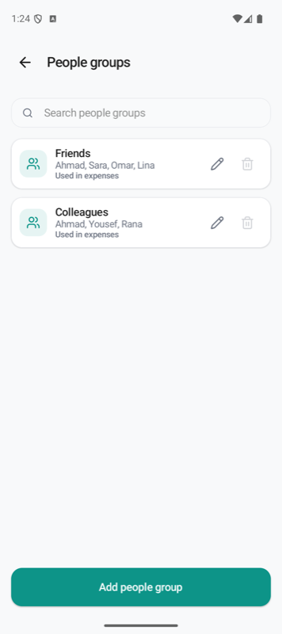 | 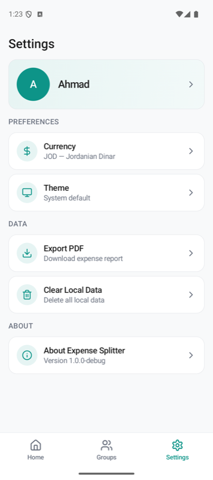 |

| Home (dark) | Stats (dark) |
|---|---|
| 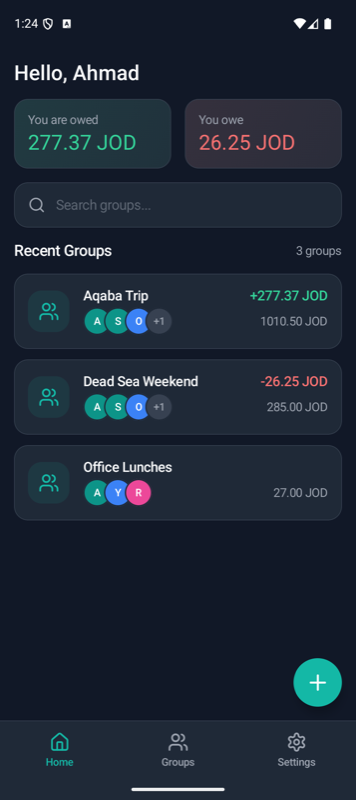 | 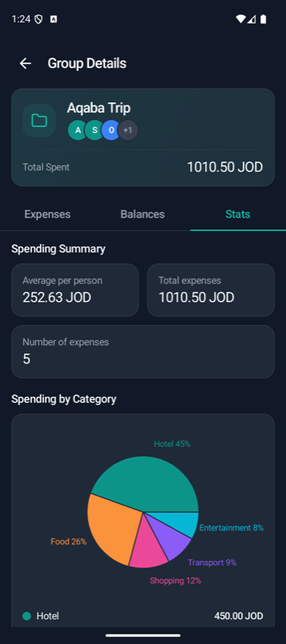 |

## Architecture

Clean Architecture with feature modules. Dependencies only point inward.

```
androidApp (Android entry)      iosApp (Swift entry, Xcode)
        \                          /
         └──────── :shared ───────┘   app shell: DI graph, navigation, start gate, iOS framework
                 /     |      \
 :feature:onboarding   |   :core:data ──► DataStore + SQLDelight (Ktor later)
        |      \       |      |
        |   :core:designsystem │
        └──────────┬───────────┘
              :core:domain       entities, repository contracts, use cases (no frameworks)
```

| Module | Responsibility | May depend on |
|---|---|---|
| `:core:domain` | `UserProfile`, `CurrencyCode`, `SupportedCurrencies`, `Expense`, `SplitCalculator`, repository interfaces, use cases, `FeatureFlags` | coroutines, kotlinx-datetime |
| `:core:data` | Repository implementations, persistence, platform file paths (`expect/actual`), Koin `dataModule` | domain |
| `:core:designsystem` | Theme from the Figma tokens (colors, type, 16dp shapes, spacing), shared icons, components (`PrimaryButton`, `AppTextField`, `AppCard`, `EmptyState`, `AppNavigationBar`), `ObserveAsEvents` | Compose |
| `:core:ui` | Compose UI that knows domain types and is shared by features (currency picker, group card, money format, expense/people group sheets and form state) | domain, designsystem |
| `:feature:*` | One user-facing feature: screen + ViewModel + Koin module (`onboarding`, `registration`, `home`, `groups`, `settings`, `expense`) | domain, designsystem, ui (**never** data or other features) |
| `:shared` | Wires everything: `initKoin`, `AppNavHost`, `AppViewModel` (start destination), `Shared.framework` | everything |

**Presentation pattern (UDF/MVI-lite)**: each screen has `UiState` (`StateFlow`), `Action`s from the UI,
and one-shot `Event`s (navigation) delivered through a `Channel`. Screens are split into a stateful
`XxxScreen` (gets its ViewModel from Koin) and a stateless, previewable `XxxContent`.

**Navigation**: type-safe Navigation Compose routes (`AppDestination`) live in `:shared` only.
Features expose callbacks like `onNavigateToRegistration`, so they don't depend on each other.

**DI**: Koin. Each module contributes a `Module`; `:shared/di/Koin.kt` assembles them.
`KoinGraphTest` checks the whole graph in CI, so a missing binding fails the build.

**Build logic**: `build-logic/convention` holds the convention plugins
`expensesplitter.kmp.library` and `expensesplitter.kmp.compose`. A new module needs about 10 lines
of Gradle. Versions live in `gradle/libs.versions.toml`.

## Current flow: onboarding gate

1. On launch, `AppViewModel` runs `ObserveOnboardingStatusUseCase` once.
2. No stored profile (name + default currency), or invalid data → **Onboarding**; otherwise → **Home**.
3. Onboarding has two actions:
   - **Register** → **Set up your profile** (`:feature:registration`): name + default currency.
     The currency field opens a bottom sheet listing every currency in use worldwide (154),
     with **Jordanian Dinar (JOD) preselected**. Search matches the currency **name or ISO code**
     ("dinar", "jod"); symbols and country names are not searched. Accent-insensitive.
     **Save & Continue** is enabled once the name is valid (1–50 chars after trimming).
     It saves the profile and opens Home, clearing onboarding from the back stack.
     Half-filled input survives process death (`SavedStateHandle`).
   - **Skip** → Home. It is hidden for now via `StaticFeatureFlags.isOnboardingSkipEnabled = false`
     (`shared/.../config/AppConfig.kt`). The ViewModel also ignores Skip while the flag is off.

## Home

After registration the app opens the main shell: bottom navigation with **Home**, **Groups** and
**Settings** (Groups/Settings are placeholders). Home shows the greeting with the registered name,
"You are owed" / "You owe" totals in the default currency, group search, and **Recent Groups**.

**Recent Groups are expense groups** (e.g. a trip); Home shows the **3** most recently active (the
header still counts all of them), the Groups tab lists every one. Their cards are computed by
`ObserveGroupsUseCase` from each expense group's expenses (`GroupSummaries.build`): the people
involved (from the people groups its expenses used), total spent, and your balance = what you paid −
your shares. Ordered by latest activity. With no groups, Home shows the generic `EmptyState` ("No groups yet",
no button). The "+" button opens **Add Expense**, where groups are created.

Money is stored as integer hundredths (`Money.minorUnits`) and always shown with two decimals,
as in the design. Totals only include groups in the user's default currency until currency
conversion exists.

## Groups tab

`:feature:groups`: title with two icons (**manage expense groups**, **manage people groups**), a
search field (matches the expense group name), filter chips and the list of every expense group
(`GroupCard` from `:core:ui`).

- **Filters** (domain: `filterGroups`): All, You owe (balance < 0), You are owed (> 0), Settled
  (= 0, including groups without expenses), Recently active (activity in the last 30 days).
- **Empty**: "No groups yet" (no button: expense groups are created from Add Expense). When groups
  exist but none match: "No groups found".
- The "+" button opens Add Expense, as on Home.

### Group Details

Tapping a group card (Home or Groups tab) opens `GroupDetailsScreen` (`:feature:groups`): a header
card (name, people involved, total spent) and three tabs, built from `ExpenseGroupDetails` (domain):

- **Expenses**: grouped by date ("Sat, Apr 25"), newest first, with category icon, "Paid by …"
  and amount.
- **Balances**: each person's paid − shares, plus recorded settlements ("Gets back" / "Owes" /
  "Settled", signed amount in green/red); balances always sum to zero. While anyone owes money the
  list ends with **Settle Up**.
- **Settle Up** (bottom sheet): the payments that clear every balance ("Lina pays Ahmad 52.75 JOD"),
  planned by `SettleUpPlanner` (largest debt pays largest credit; at most people − 1 payments).
  **Mark as Settled** stores them as `Settlement`s in one transaction (`SettleUpUseCase`), which
  brings every balance, including "your balance" on Home, to zero and hides the button. A later
  expense makes balances non-zero again and Settle Up comes back.
- **Stats**: summary cards (average per person, total, number of expenses), spending by category
  (pie chart with "Hotel 45%" labels and a legend) and spending by member (what each person paid,
  bar chart with a round axis from `ChartScale`). Charts are drawn with Compose `Canvas`, no
  chart library.

The floating "+" (Expenses tab only) opens Add Expense with this expense group preselected (route
argument `expenseGroupId`). If the group is deleted elsewhere, the screen closes itself.

### Expense Details

Tapping an expense in Group Details opens `ExpenseDetailsScreen` (`:feature:expense`): header
(category, title, date or date range, amount), **Paid By**, **Split Between** with each share, then:

- **Edit**: opens the expense form ("Edit Expense") filled with the expense (route argument
  `expenseId`). Percentages aren't stored, so they are derived from the shares (adjusted to total
  100%). "Save Changes" updates the same expense (same id) via `AddExpenseUseCase(draft, editingId)`.
- **Delete**: confirmation sheet, then `DeleteExpenseUseCase`. The screen closes when the expense
  no longer exists (deleted here or elsewhere).

### Manage expense groups / people groups

Opened from the Groups tab header and from the **Manage** buttons in Add Expense's group sheets.
Each has a search field, the list with **edit** and **delete** per item, and an **Add** button.
Add/Edit use the shared sheets in `:core:ui` (`CreateExpenseGroupSheet`, `PeopleGroupSheet`).

- **Expense groups**: rename keeps the id. Delete asks for confirmation and also deletes the group's
  expenses ("Its 2 expenses will be deleted too").
- **People groups**: search matches group or member names. **Delete is enabled only for groups no
  expense uses.** When editing, people referenced by an expense (payer or share) show "In expenses"
  and can't be removed; anyone else can be added or removed.
- One set of people group rules for create and edit: `PeopleGroupRules` (domain) and
  `PeopleGroupFormEditor` (shared form state in `:core:ui`, used by Add Expense too).

## Add Expense

Opened from the Home "+" button (`:feature:expense`). Fields in order: title, **expense group**,
**date**, **people group**, amount (default currency), category, payer, split type, people to split
between, note. Expense group and people group are both required.

Two kinds of group:

| | Expense group (`ExpenseGroup`) | People group (`PeopleGroup`) |
|---|---|---|
| What | Related expenses, e.g. "Aqaba Trip" | Who an expense is split between |
| Has | Name + generated unique id (never shown; names may repeat) | Name + members |
| Shown | Home → Recent Groups | Add Expense → Split Between / Paid By |

One expense group can contain expenses split within different people groups.

- **Expense group**: preselects the newest one. Its sheet has a search field (by name) and **Manage
  expense groups**, which opens the same screen as the Groups tab button (add, rename, delete).
- **Date**: a calendar sheet (dates up to today). The first tap sets a one-day expense (start = end);
  a second tap sets the end date, e.g. a hotel stay. Shown as "Today, …" or "November 2 – November 4, 2026".
- **People group**: preselects the first (newest) group when groups exist, else "No group". The group
  sheet's **Manage people groups** opens the same screen as the Groups tab button (add, edit, delete).
- **Coming back from a Manage screen** keeps everything typed. The form follows the changes live:
  with nothing selected, a newly added group is selected; a deleted selected group falls back to the
  newest; edited members of the selected people group are all ticked again (and the payer is kept
  only if still a member).
- **Split Between** lists the selected people group's members, all ticked; it is disabled without one.

- **Split rules live in the domain** (`SplitCalculator`): *Equal* divides between ticked people,
  *Percentage* needs exactly 100%, *Exact* needs amounts that add up to the total. Everything is in
  integer hundredths; leftover cents go to the people with the largest rounding loss, so shares
  always add up to the total exactly.
- `AddExpenseUseCase.validate` is the single set of rules: the ViewModel runs it on every change to
  enable **Save** (outlined until valid, then filled) and to turn the split hint red, and the use case
  enforces it again on save.
- Expense groups, people groups, expenses and settlements are stored in SQLite; see
  [Local database](#local-database).

## Local database

Expense groups, people groups (+ members), expenses (+ shares) and settlements live in one SQLite
database, `expense_splitter.db`, through **SQLDelight** (`:core:data`). The profile and preferences
stay in DataStore.

- **Schema**: `core/data/src/commonMain/sqldelight/.../db/*.sq`. SQLDelight generates type-safe
  Kotlin (`AppDatabase`) from the SQL at build time.
- **Repositories**: `SqlDelight*Repository` implement the domain contracts. Reads are `Flow`s that
  re-emit after every write; a parent and its children (group + members, expense + shares) are
  written in one transaction and read with one join, so observers never see half an update.
- **Encodings**: money as minor units + ISO 4217 code (never floating point), dates as ISO
  `yyyy-MM-dd` text (sorts correctly), enums by name. Changing these is a data migration.
- **Drivers**: `AndroidSqliteDriver` (app-private `databases/`) and `NativeSqliteDriver`
  (`Library/Application Support/databases`) from `platformDataModule`. The iOS app links
  `-lsqlite3` (Xcode `OTHER_LDFLAGS`).
- **Migrations**: the version-1 schema snapshot is in `src/commonMain/sqldelight/databases/1.db`.
  For a schema change add `1.sqm` (the SQL that upgrades 1 → 2), run
  `./gradlew :core:data:generateCommonMainAppDatabaseSchema`, and
  `./gradlew :core:data:verifySqlDelightMigration` proves the migration produces the new schema.
- **Clear local data** wipes DataStore and every table in one transaction.
- **Tests** run the real SQL against an in-memory database on both the JVM (JDBC driver) and the iOS
  simulator (native driver).

## Settings

Profile card (tap to edit the name), **Preferences** (currency, theme), **Data** (export, clear) and
**About**. Every row opens a bottom sheet:

- **Edit name**: same rules as registration (1–50 characters).
- **Currency**: the same searchable sheet as registration (`CurrencyPickerSheet` in `:core:ui`).
- **Theme**: Light, Dark or System default. Stored in DataStore and applied app-wide, including
  status-bar icon colors (`SystemBarsAppearance`).
- **Export PDF**: enabled only when groups exist. The PDF writer is still a placeholder
  (`UnavailableExpenseReportExporter`) because expenses aren't stored yet; replace that binding in
  `dataModule` with platform writers (Android `PdfDocument`, iOS `UIGraphicsPDFRenderer`).
- **Clear local data**: confirmation sheet with a red action. Wipes profile, groups and preferences,
  then restarts at onboarding.
- **About**: version (from Android `versionName` / iOS `CFBundleShortVersionString`) and a short summary.

## Build variants

| | Android | iOS |
|---|---|---|
| Debug | `assembleDebug` · app id `…kmpexpensesplitter.debug` · "Expense Splitter (Debug)" · verbose logs | Xcode *Debug* config · `isDebug = true` |
| Release | `assembleRelease` · R8 minify + resource shrinking · logs ≥ Warn only | Xcode *Release* config · `isDebug = false` |

The flag reaches shared code through `AppConfig(isDebug)`: from `BuildConfig.DEBUG` on Android and the
Swift `#if DEBUG` on iOS.

**Release signing (Android)**: create a git-ignored `keystore.properties` at the repo root with
`storeFile`, `storePassword`, `keyAlias` and `keyPassword`. On CI, set
`EXPENSE_SPLITTER_STOREFILE` and the matching env vars instead. Without these, the build produces
an unsigned APK.

## Security

- **No backup/transfer of user data**: `allowBackup=false` + `data_extraction_rules.xml`.
- **HTTPS only**: `network_security_config.xml` disables cleartext and trusts system CAs only.
- **Storage**: app-private `filesDir` / `databases/` on Android; `Library/Application Support` on iOS
  (not exposed via the Files app, protected by iOS Data Protection). The database holds trip names,
  people's names and amounts; it is excluded from backups like everything else.
  Secrets such as auth tokens must go to Keystore/Keychain, not DataStore, when sync is added.
- **Validation at the boundaries**: `CurrencyCode.of()` validates ISO 4217 input. Persisted data is
  re-validated on read, and corrupt data falls back to onboarding instead of crashing.
- **No PII in logs**. Release builds log warnings/errors only, and R8 strips `Log.v/d`.

## Testing

Tests are written once in `commonTest` and run on the JVM and the iOS simulator
(kotlin-test, coroutines-test, Turbine, and hand-written fakes in place of mocks).

```bash
./gradlew testAndroidHostTest         # all modules, JVM (fast)
./gradlew iosSimulatorArm64Test       # all modules, iOS simulator
./gradlew :androidApp:assembleDebug :androidApp:assembleRelease
```

| Test | Covers |
|---|---|
| `CurrencyCodeTest` | ISO code parsing/normalization |
| `ObserveOnboardingStatusUseCaseTest` | onboarding rule, de-duplication |
| `DataStoreUserProfileRepositoryTest` | persistence, invalid/corrupt data fallback |
| `OnboardingViewModelTest` | Skip flag, navigation events, event buffering |
| `RegisterUserUseCaseTest` | name rules, trimming, storage failure |
| `SupportedCurrenciesTest` | catalog integrity, JOD default |
| `SearchCurrenciesUseCaseTest` | name/code search, countries & symbols excluded, ranking, accents |
| `RegistrationViewModelTest` | form state, currency menu, save success/failure, state restoration |
| `CalculateBalanceSummaryUseCaseTest` | owed/owe totals, currency isolation |
| `HomeViewModelTest` | greeting, zero balances, empty state, group search |
| `MoneyFormatTest` | `97.75 JOD` / `+85.25 JOD` / `-45.00 JOD` formatting |
| `SettingsUseCasesTest` | edit name/currency, clear data, export gating |
| `LocalSettingsDataSourcesTest` | theme persistence, clear-all (DataStore + database), export placeholder |
| `SqlDelightRepositoriesTest` | real SQLite round trips, ordering, member/share order, cascades, reopen |
| `SettleUpPlannerTest` / `SettleUpUseCaseTest` | settle-up plan clears balances, atomic recording |
| `ExpenseGroupDetailsTest` | balances with settlements, member spending, average, category totals |
| `ChartScaleTest` | bar chart axis ticks and labels |
| `SettingsViewModelTest` | sheets, name edit, currency, theme, export enablement, clear data |
| `AppViewModelTest` | start destination, resolved once |
| `KoinGraphTest` | complete DI graph |

## iOS integration

- `Shared.framework` (static) is built by the Xcode run script
  `./gradlew :shared:embedAndSignAppleFrameworkForXcode`; open `iosApp/iosApp.xcodeproj`.
- Swift calls `MainViewControllerKt.startKoin(isDebug:)` in `iOSApp.init()`, then hosts
  `MainViewControllerKt.MainViewController()` inside SwiftUI (`ContentView.swift`).
- Native SwiftUI screens can be added next to the Compose UI when a flow needs platform-specific UX.
- For distribution as a package (SPM/CocoaPods) to another iOS app, add an XCFramework task or the
  `cocoapods` plugin to `:shared`. The direct framework integration is enough for this app.

## Currency data

`core/domain/.../model/CurrencyData.kt` is **generated** from Unicode CLDR: every currency that is
legal tender today, with English names, symbols (the issuing country's local symbol when English
has none, e.g. `د.أ.` for JOD) and the countries using it.

Product decisions applied on top of CLDR (constants at the top of the script, enforced by
`SupportedCurrenciesTest`):

- Israel is not listed; the shekel (ILS) is shown as **New Shekel** under **Palestine**.
- Palestine is always named "Palestine".
- Jordanian Dinar is listed under Jordan only.

To refresh it after a CLDR update:

```bash
python3 -m venv /tmp/venv && /tmp/venv/bin/pip install babel==2.17.0
/tmp/venv/bin/python scripts/generate_currencies.py
```

## Design notes

- **Dark theme** follows the system setting. Dark colors come from the Figma dark Home design:
  background `#111827`, cards/bottom bar `#1F2937`, borders `#374151`, text `#F9FAFB`/`#9CA3AF`,
  primary `#14B8A6`, positive `#34D399`, negative `#F87171`. Icons are tinted from the theme at
  runtime (their SVG colors are placeholders), so they switch automatically. Multi-color art uses a
  `drawable-dark/` variant (see the onboarding illustration).
- **Spacing rule:** every screen uses a 16dp left/right margin (`spacing.screenHorizontal`) and the
  space between views never exceeds 16dp (`spacing.md`, the largest step in the scale). This
  overrides the larger gaps in the Figma exports.
- **Strings:** Compose resources don't process Android `\'` / `\"` escapes; use ’ and “ ” in `strings.xml`.
- Values come from the Figma file "Expense splliter" (page "onbording") and live in `:core:designsystem/theme`.
- The design uses **Inter**; the app currently uses the platform font (Roboto / SF Pro). To match exactly,
  add the Inter `.ttf` files to `core/designsystem/src/commonMain/composeResources/font/` and set
  `fontFamily` in `Type.kt`.
- Compose resources in library modules need `androidResources { enable = true }` on Android;
  the `expensesplitter.kmp.compose` convention plugin turns this on for every UI module.

## Adding a feature

1. Create `feature/<name>/build.gradle.kts` with `alias(libs.plugins.expensesplitter.kmpCompose)`.
2. `include(":feature:<name>")` in `settings.gradle.kts`.
3. Add `XxxContract.kt`, `XxxViewModel.kt`, `XxxScreen.kt` and `di/XxxModule.kt`, plus tests in `commonTest`.
4. Register the Koin module in `allModules()` and the route in `AppNavHost`.
